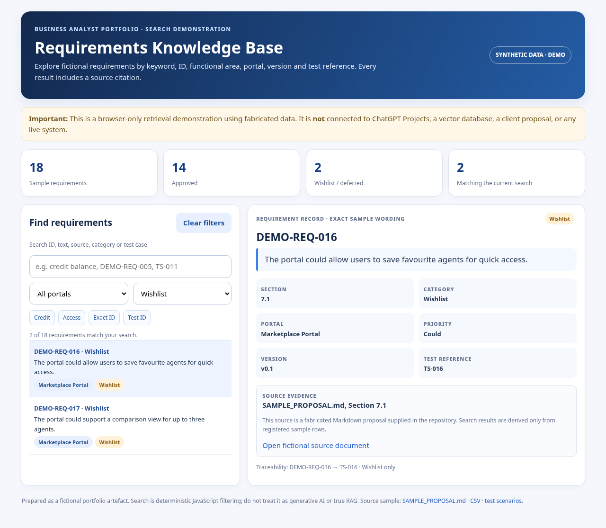
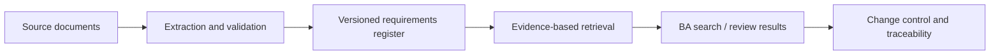

# AI-Assisted Requirements Knowledge Base — Portfolio Demo

> **Public portfolio, fictional data.** This repository is an independently prepared illustration of the design and search experience of a ChatGPT-based requirements knowledge base. It contains **no client proposal or internal requirements**. It is not a production RAG service.

## Live demonstration

Once GitHub Pages is enabled, open the repository's GitHub Pages URL to try the searchable sample requirement register. The demo runs entirely in the browser; there is no API key, AI service or backend.

## Business problem and objective

Business Analysts may need to find, verify and trace requirements across long proposals and multiple sections. The intended ChatGPT Project workflow was designed to answer natural-language queries while retaining original requirement wording, stable IDs, document evidence, version details and scope boundaries.

## What is included here

| File | Purpose |
|---|---|
| `index.html` | Working browser demo for searching 18 **fictional** requirements |
| `SAMPLE_PROPOSAL.md` | Fabricated source document with matching sample requirement IDs |
| `sample_requirements.csv` / `.json` | Machine-readable fictional requirement register |
| `CHATGPT_PROJECT_INSTRUCTIONS.md` | Generic reusable instructions for a ChatGPT Project |
| `TEST_CASES.md` | Manual functional test scenarios and expected results |
| `PORTFOLIO_NOTES.md` | Architecture, limitations and BA contributions |

## Demonstrated requirements-management concepts

- Search by **requirement ID**, keyword, portal, category, status, version or test reference.
- Show **exact stored wording** rather than an invented paraphrase.
- Display **source file and section**, priority, status and requirement version.
- Distinguish **Approved**, **In review** and **Wishlist** requirements.
- Report **no matching evidence** rather than fabricating a requirement.
- Trace a requirement to a fictional test scenario ID.

## Architecture

**Portfolio demo implementation:** prewritten JSON embedded in a self-contained HTML page, filtered using JavaScript.

**ChatGPT Project concept:** file-backed retrieval with evidence checks and source citation. Do not confuse the working browser demo with vector indexing, embeddings, or a separate production RAG pipeline.

## Run locally

Download `index.html` and open it in a modern browser. No build tools or dependencies are needed.

## GitHub Pages

In the repository, open **Settings → Pages**, choose **Deploy from a branch**, then `main` and `/(root)`. The `index.html` file becomes the landing page.

## Business Analyst contribution

The portfolio presents a BA-led workflow: document intake, requirement structuring, search expectations, evidence rules, ID/version preservation, coverage checks, traceability and acceptance-test design. ChatGPT was used to assist with documentation, example data and front-end demonstration implementation.

## Safety and attribution

All organisations, systems, IDs, requirements and data in this repository are fabricated. This demonstration makes no claim to contain actual client information or to reproduce proprietary project logic. Never upload confidential requirements to a public portfolio without authorisation.
